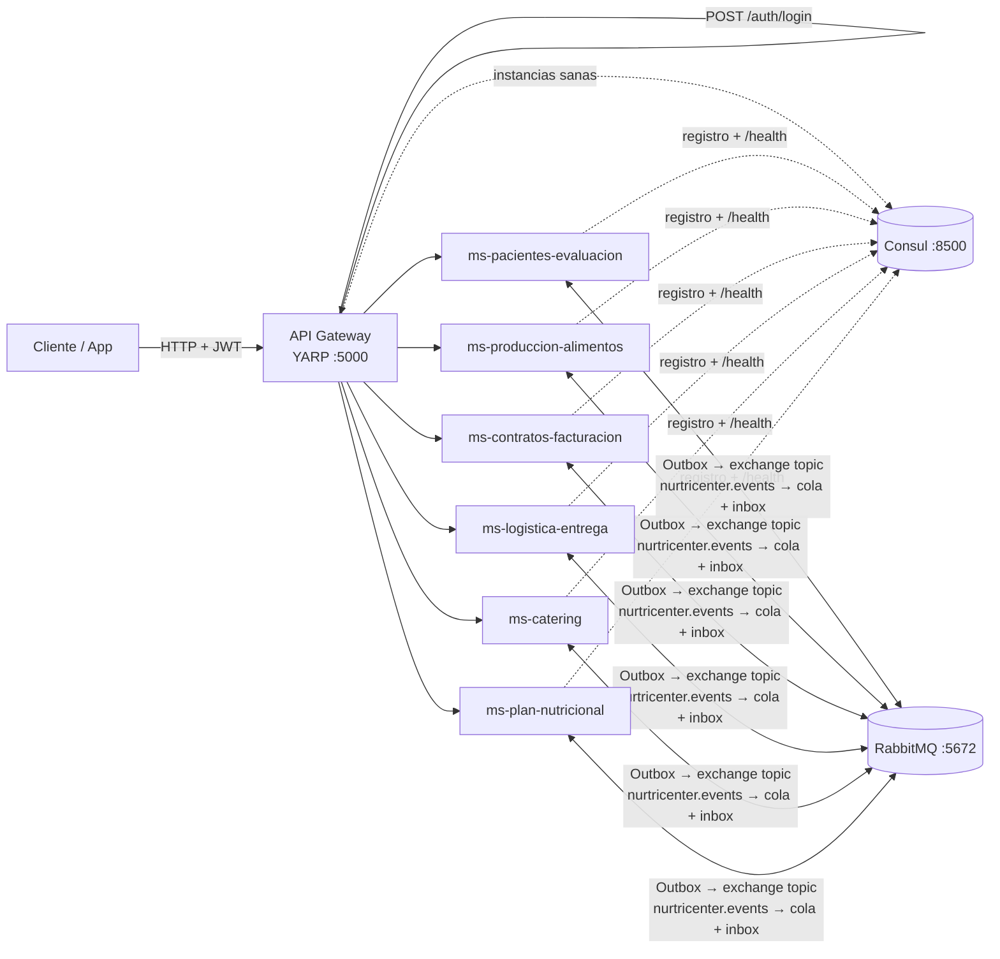

# Arquitectura de NUR-TRICENTER (Defensa final, Módulo 5)

Este documento actualiza `UNIVERSIDAD NUR -.docx`. Ese documento todavía tenía 7 bounded contexts y un integrante que ya no está. El sistema actual tiene **6 microservicios**. BC1 *Gestión de Pacientes* y BC2 *Evaluación y Seguimiento* se fusionaron en **ms-pacientes-evaluacion**. Los contratos de eventos parten de `Eventos_Integracion_NUR-TRICENTER.docx` y se ajustaron a lo que realmente viaja por el broker (ver §4).

## 1. Requisitos de la defensa y dónde se cumplen

| Requisito (`Defensa_Final_Modulo_5.txt`) | Implementación |
|---|---|
| API Gateway para exponer los microservicios | `ms-api-gateway` (.NET 8 + YARP). Enruta por prefijo: `/pacientes`, `/produccion`, `/contratos`, `/logistica`, `/catering` y `/plan-nutricional`. |
| Service Discovery | **Consul**. Cada instancia se registra al arrancar con un health check HTTP a `/health` y se da de baja al apagarse. El Gateway consulta cada 10 s las instancias sanas y balancea entre ellas. |
| Integración de los microservicios | Los 6 servicios y la infraestructura se levantan con `docker-compose.sistema.yml`. El flujo completo se verifica con `pruebas/flujo-e2e.ps1`. |
| Seguridad en los endpoints | **JWT** HS256 emitido por el Gateway (`POST /auth/login`), con issuer `nurtricenter-gateway` y audience `nurtricenter-api`; el rol viaja en el claim `rol`. El Gateway exige el token en todas las rutas, y **cada servicio lo vuelve a validar** y autoriza por rol, así que no se puede saltar el Gateway. El login tiene rate limiting. |
| Transactional Outbox | En los 6 servicios. El evento se guarda en la tabla outbox **en la misma transacción** que el agregado, y un relay en segundo plano lo publica a RabbitMQ con *publisher confirms*. |
| Comunicación interna asíncrona por un broker | **RabbitMQ**, exchange topic `nurtricenter.events`. Cada servicio tiene una cola durable, un inbox idempotente (`eventos_procesados`) y una dead-letter queue. **No hay llamadas HTTP entre servicios.** |

## 2. Vista general



| Microservicio | Repo | Stack | Base de datos | Consul | Cola RabbitMQ | Puerto directo |
|---|---|---|---|---|---|---|
| Pacientes y Evaluación (BC1) | `katering/ms-pacientes-evaluacion` | .NET 8 | SQL Server 2022 | `pacientes` | `ms-pacientes.eventos` | 5144 |
| Producción de Alimentos | `katering/ms-produccion-alimentos` | .NET 8 | SQL Server 2022 | `produccion` | `ms-produccion.eventos` | 5234 |
| Contratos y Facturación | `elvis/ms-contratos-facturacion-modulo2` | .NET 10 | PostgreSQL 16 | `ms-contratos` | `ms-contratos.eventos` | 5030 |
| Logística de Entrega | `elvis/ms-logistica-entrega-modulo4` | .NET 10 | PostgreSQL 16 | `ms-logistica` | `ms-logistica.eventos` | 5060 |
| Gestión de Catering | `luis/Repo-ms-catering` | Python / FastAPI | PostgreSQL 15 | `ms-catering` | `ms-catering.eventos` | 8020-8022 (3 réplicas) |
| Planificación Nutricional | `luis/Repo-ms-plan-nutricional` | Python / FastAPI | PostgreSQL 15 | `ms-plan-nutricional` | `ms-plan-nutricional.eventos` | 8010 |

Cada servicio tiene **su propia base de datos** (*database per service*). Los puertos directos sirven solo para depurar: sin un JWT válido responden 401.

## 3. Patrones de mensajería

```mermaid
sequenceDiagram
    participant H as Handler (caso de uso)
    participant DB as Base del productor
    participant R as Relay del Outbox
    participant MQ as RabbitMQ
    participant K as Consumidor
    participant DB2 as Base del consumidor
    H->>DB: BEGIN; guarda agregado + fila outbox; COMMIT
    loop cada 2-3 s
        R->>DB: filas sin publicar (en orden)
        R->>MQ: publish (persistente, MessageId = id de la fila) + confirm
        R->>DB: marca la fila como publicada
    end
    MQ->>K: entrega (al menos una vez)
    K->>DB2: ¿MessageId en eventos_procesados?
    alt nuevo
        K->>DB2: aplica el evento + registra el MessageId
        K->>MQ: ack
    else duplicado
        K->>MQ: ack (se ignora)
    end
```

- **Outbox.** Si RabbitMQ está caído, la fila queda pendiente y se publica cuando vuelve. Ningún evento se pierde y ninguno se publica sin que el cambio esté guardado.
  - Los .NET de Katering escriben la fila en el handler, en el mismo `SaveChanges`.
  - Los .NET de Elvis la escriben desde `OutboxIntegrationEventPublisher`, dentro de `UnitOfWork.CommitAsync`, antes de `SaveChanges`.
  - Los Python la escriben en `guardar()` del repositorio, en la misma sesión.
- **Inbox.** RabbitMQ entrega «al menos una vez». El `MessageId` (el id de la fila del outbox) evita aplicar dos veces el mismo evento.
- **Dead-letter queue.** En los .NET, un mensaje que no cumple el contrato, o que falla dos veces, va a `{cola}.dlq` por el exchange `nurtricenter.events.dlx`.
- **Reconexión.** Si el broker se reinicia, los publicadores y los consumidores se reconectan solos.
- **Formato.** El payload viaja sin sobre. Los .NET publican en camelCase con enums como string; los Python, en snake_case. Los consumidores aceptan ambos.

## 4. Catálogo de eventos implementado

| Routing key | Productor | Consumidores y reacción |
|---|---|---|
| `paciente.registrado` | pacientes | **contratos**: crea la réplica `PacienteConocido` (nombre, CI). **produccion**: bitácora. |
| `evaluacion.registrada` | pacientes | **contratos**: si es CONTROL y el paciente no tiene catering vigente, genera y factura un control adicional (RN-06). |
| `servicio.contratado` | contratos | **catering** (CATERING): crea el calendario del período. **plan-nutricional** (ASESORAMIENTO): habilita el asesoramiento. **produccion** (CATERING): guarda contrato, nombre y CI en su réplica. **pacientes**: bitácora. |
| `factura.emitida` | contratos | Externo (contabilidad). |
| `contrato.cancelado` | contratos | **catering**: cancela el calendario. **plan-nutricional**: revoca el asesoramiento. **pacientes**: bitácora. |
| `contrato.completado` | contratos | **catering**: completa el calendario. **pacientes**: bitácora. |
| `plan_nutricional.creado` | plan-nutricional | **contratos**: guarda inicio y duración del plan, de donde deriva la vigencia del catering (RN-01b). **catering**: recuerda el plan vigente del paciente y lo vincula al calendario. El plan siempre llega antes que el calendario, porque contratos exige el plan para contratar catering (C2). |
| `plan_nutricional.actualizado` | plan-nutricional | **produccion**: bitácora. |
| `plan_nutricional.finalizado` / `.cancelado` | plan-nutricional | **catering**: completa o cancela el calendario. |
| `calendario.creado` | catering | **produccion**: dirección de entrega por defecto en su réplica. |
| `direccion_entrega.cambiada` | catering | **produccion**: dirección del día puntual. |
| `dia_sin_entrega.marcado`, `calendario.cancelado` | catering | **produccion**: bitácora. |
| `calendario.completado` | catering | **produccion** y **pacientes**: bitácora. |
| `orden.cancelada` | produccion | **pacientes**: bitácora. |
| `paquetes.listos` | produccion | **logistica**: registra los paquetes por asignar a una ruta (idempotente por `paqueteId`). |
| `ruta.optimizada` | logistica | Externo (app del repartidor). |
| `entrega.confirmada` | logistica | **pacientes**: historial de entregas. |
| `incidencia_entrega.registrada` | logistica | **pacientes**: historial. **catering**: si el motivo es imputable a la empresa (`PAQUETE_DANADO`), agrega un día de reposición. |

En «bitácora», el evento queda registrado en el inbox del servicio y se puede consultar en `GET /api/integracion/eventos-recibidos` (Pacientes y Producción).

### Ajustes respecto de `Eventos_Integracion_NUR-TRICENTER.docx`

- `PacienteRegistrado` agrega `nroIdentificacion` y `contacto { telefono, email, direccion }`, que pide ms-contratos (§5.4 del documento). Pacientes ahora guarda el CI (`NroIdentificacion`).
- `PaquetesListosParaEntrega` (`paquetes.listos`) lo publica Producción con el contrato del pact de Logística. La dirección y las coordenadas salen de su réplica de catering. Si la dirección no tiene coordenadas, se usa el centro de Santa Cruz (registrado como INC-4 en ms-logistica).
- `EntregaConfirmada` e `IncidenciaEntregaRegistrada` las produce Logística, que reemplaza las propuestas `EntregaConfirmada`/`EntregaFallida` de Producción (§5.5 del documento).
- `ContratoCancelado` y `ContratoCompletado` pasaron de «propuestos» a implementados.
- Siguen pendientes, como propuestas: `PlanAlimenticioAsignado`, `CalendarioEntregaActualizado`, `PedidoDeAlimentacionGenerado`, `OrdenDeProduccionGenerada` y `EntregasDelDiaConfirmadas`.

## 5. Seguridad

| Rol | Usuario demo | Puede |
|---|---|---|
| `admin` | `admin` / `admin123` | Todo |
| `nutricionista` | `nutricionista` / `nutri123` | Pacientes, evaluaciones, planes, catálogo de recetas y plantillas |
| `paciente` | `paciente` / `paciente123` | Leer su calendario y su plan, modificar su calendario, ver sus facturas |
| `cocina` | `cocina` / `cocina123` | Órdenes de producción y paquetes |
| `repartidor` | `repartidor` / `repartidor123` | Su ruta, confirmar entregas y registrar incidencias |

El secreto compartido se configura con la variable `JWT_SECRET` (ver `.env.example`). `/health` queda abierto en todos los servicios porque Consul lo consulta sin token.

## 6. Comunicación síncrona aceptada

La única comunicación HTTP es **cliente → Gateway → servicio**. Los clientes HTTP entre servicios que quedaron de módulos anteriores **no se usan en ejecución**: no están registrados en el contenedor de dependencias y solo los usan los tests Pact. Son `PacientesApiClient` en Producción y `PacienteGatewayHttp` en Catering y Plan Nutricional.

## 7. Cómo se levanta y se prueba

```powershell
cd ms-api-gateway
./scripts/levantar.ps1                                         # infraestructura + 6 servicios
powershell -ExecutionPolicy Bypass -File pruebas/flujo-e2e.ps1 # flujo completo por el Gateway
```

- Consul: http://localhost:8500/ui
- RabbitMQ: http://localhost:15672 (guest/guest)
- Gateway: http://localhost:5000

**Demo del Outbox.**

1. Detener el broker: `docker stop rabbitmq`.
2. Registrar un paciente: responde 201 y el evento queda pendiente en `OutboxMessages`.
3. Volver a levantarlo: `docker start rabbitmq`. En unos segundos el relay publica el evento y ms-contratos lo recibe.

**Demo de balanceo.**

1. Escalar catering: `docker compose -f docker-compose.sistema.yml up -d --scale catering_api=3`.
2. Consul muestra 3 instancias de `ms-catering` y el Gateway reparte las peticiones entre ellas.
