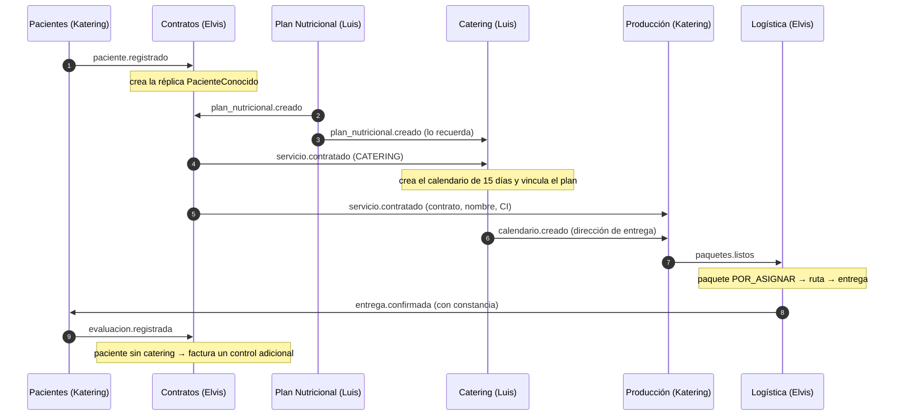

# Flujo de la presentación: Defensa Final Módulo 5

Guion para unos **20 minutos** de exposición y demo en vivo. Cada bloque dice qué mostrar, quién lo presenta, qué comando correr y qué decir. Los comandos son de PowerShell y se ejecutan desde `ms-api-gateway/`.

| Bloque | Tiempo | Quién | Requisito que cubre |
|---|---|---|---|
| 0. Preparación (antes de entrar) | — | Todos | — |
| 1. El problema y los 6 contextos | 2 min | Luis | Integración de los microservicios |
| 2. Arquitectura | 3 min | Luis | Gateway, Service Discovery, broker |
| 3. Demo: infraestructura viva | 2 min | Katering | Service Discovery |
| 4. Demo: seguridad | 2 min | Elvis | Seguridad de endpoints |
| 5. Demo: flujo de negocio por eventos | 5 min | Todos (cada uno su servicio) | Comunicación asíncrona por broker |
| 6. Demo: Transactional Outbox | 3 min | Katering | Transactional Outbox |
| 7. Demo: balanceo con réplicas | 1 min | Luis | Service Discovery + Gateway |
| 8. Cierre y preguntas | 2 min + preguntas | Todos | — |

---

## 0. Preparación (antes de entrar)

```powershell
cd ms-api-gateway
./scripts/levantar.ps1                    # 17 contenedores; la primera vez tarda varios minutos
docker ps --format "table {{.Names}}\t{{.Status}}"
```

- [ ] Los 17 contenedores en `Up` (`catering_migrate` termina en `Exited (0)`, que es lo esperado).
- [ ] Consul (http://localhost:8500/ui) muestra 7 servicios en verde.
- [ ] Corrida de ensayo: `powershell -ExecutionPolicy Bypass -File pruebas/flujo-e2e.ps1`. Debe terminar en «todas las verificaciones pasaron».
- [ ] **Esperar 1 minuto antes de la demo real**: el login tiene rate limiting (10 intentos por minuto) y el ensayo los consume.
- [ ] Pestañas abiertas: Consul UI, RabbitMQ (http://localhost:15672, guest/guest), `documentacion/ARQUITECTURA.md`.

---

## 1. El problema y los 6 contextos (2 min)

**Mostrar:** `UNIVERSIDAD NUR -.docx`, la sección del Context Map.

**Decir:**
- NUR-TRICENTER gestiona pacientes, planes nutricionales, contratos, catering, cocina y reparto.
- Al principio eran 7 contextos. Gestión de Pacientes y Evaluación se **fusionaron**, porque comparten el agregado Paciente. Quedan **6 microservicios**, de 3 integrantes, en 3 stacks distintos: .NET 8, .NET 10 y Python/FastAPI.
- Cada uno tiene **su propia base de datos** (SQL Server o PostgreSQL) y no comparte tablas con nadie.

## 2. Arquitectura (3 min)

**Mostrar:** el diagrama de `documentacion/ARQUITECTURA.md` §2 y la tabla de requisitos de §1.

**Decir:**
1. **API Gateway (YARP).** Es la única puerta de entrada. Emite el JWT (`POST /auth/login`) y lo exige en todas las rutas.
2. **Consul.** Cada servicio se registra solo al arrancar, con un health check a `/health`. El Gateway no tiene direcciones fijas: cada 10 s le pregunta a Consul qué instancias están sanas.
3. **RabbitMQ.** Toda la comunicación entre servicios es por eventos, a través del exchange `nurtricenter.events`. **No hay ninguna llamada HTTP entre microservicios.**
4. **Transactional Outbox.** El evento se guarda en la misma transacción que el dato. Un relay lo publica después, así que si el broker se cae, no se pierde nada.
5. **Inbox y DLQ.** Cada consumidor registra el `MessageId` para no procesar dos veces el mismo mensaje. Lo que no cumple el contrato va a la dead-letter queue.

## 3. Demo: infraestructura viva (2 min)

**Consul** (http://localhost:8500/ui):
- 7 servicios en verde: `api-gateway`, `pacientes`, `produccion`, `ms-contratos`, `ms-logistica`, `ms-catering` y `ms-plan-nutricional`.
- Abrir uno y mostrar el **health check** `/health` y la IP del contenedor.

**RabbitMQ** (http://localhost:15672, pestaña *Exchanges* → `nurtricenter.events` → *Bindings*):
- Una cola por servicio (`ms-pacientes.eventos`, `ms-contratos.eventos`, …), cada una enlazada a las routing keys que le interesan.
- Pestaña *Queues*: las colas `*.dlq` de los servicios .NET, vacías.

## 4. Demo: seguridad (2 min)

```powershell
# Sin token: el Gateway responde 401
curl.exe -s -o NUL -w "%{http_code}`n" http://localhost:5000/pacientes/api/pacientes

# Login: el Gateway emite el JWT con el rol
$admin = (Invoke-RestMethod -Method Post http://localhost:5000/auth/login -ContentType "application/json" `
          -Body '{"usuario":"admin","password":"admin123"}').accessToken
$paciente = (Invoke-RestMethod -Method Post http://localhost:5000/auth/login -ContentType "application/json" `
          -Body '{"usuario":"paciente","password":"paciente123"}').accessToken

# Con token: 200
curl.exe -s -o NUL -w "%{http_code}`n" -H "Authorization: Bearer $admin" http://localhost:5000/pacientes/api/pacientes

# Rol sin permiso: 403 (un paciente no puede crear servicios en el catálogo)
curl.exe -s -o NUL -w "%{http_code}`n" -X POST -H "Authorization: Bearer $paciente" -H "Content-Type: application/json" `
  -d '{\"tipo\":\"EVALUACION\",\"nombre\":\"x\",\"precio\":1,\"moneda\":\"BOB\"}' http://localhost:5000/contratos/api/servicios

# Saltarse el Gateway no sirve: el servicio también valida el JWT -> 401
curl.exe -s -o NUL -w "%{http_code}`n" http://localhost:5144/api/pacientes
```

**Decir:** el token se valida dos veces, en el Gateway y en cada servicio. El rol viaja en el claim `rol` y cada servicio decide qué roles admite (admin, nutricionista, paciente, cocina, repartidor). Opcional: pegar el token en https://jwt.io para mostrar los claims.

## 5. Demo: flujo de negocio por eventos (5 min)

```powershell
powershell -ExecutionPolicy Bypass -File pruebas/flujo-e2e.ps1
```

El script recorre el flujo completo **solo por el Gateway** y, en cada paso, espera a que el evento llegue por RabbitMQ al servicio que debe reaccionar. Mientras corre, cada integrante explica el paso de su servicio:



| Paso del script | Quién explica | Qué decir |
|---|---|---|
| 3. Paciente registrado | Katering | Pacientes guarda el paciente y, en la misma transacción, la fila de Outbox `paciente.registrado`. Contratos arma su réplica local; nunca consulta a Pacientes por HTTP |
| 4-5. Plan y contrato de catering | Luis y Elvis | Contratos exige un plan activo para contratar catering (C2) y deriva la vigencia del plan. `servicio.contratado` hace que Catering cree el calendario y vincule el plan que ya conocía |
| 6. Paquete listo | Katering | Producción arma el paquete con los datos de su réplica (contrato, CI, dirección) y publica `paquetes.listos` |
| 7. Ruta y entrega | Elvis | Logística registra el paquete, optimiza la ruta y el repartidor confirma con foto. `entrega.confirmada` llega al historial de Pacientes |
| 8. Control adicional | Elvis y Katering | La evaluación de un paciente sin catering genera, por evento, el cobro de un control adicional |

Para mostrar lo que recibió un servicio:

```powershell
Invoke-RestMethod -Headers @{Authorization="Bearer $admin"} "http://localhost:5000/pacientes/api/integracion/eventos-recibidos?cantidad=5"
```

## 6. Demo: Transactional Outbox (3 min)

```powershell
# 1) Apagar el broker
docker stop rabbitmq

# 2) Registrar un paciente: la API responde 201 aunque RabbitMQ esté caído
$body = '{"nombre":"Outbox","apellido":"Demo","fechaNacimiento":"1990-01-01","email":"outbox@demo.com","direccion":"Av. Demo 1","telefono":"70000009","nutricionistaId":"' + [guid]::NewGuid() + '","nroIdentificacion":"5550001"}'
$id = (Invoke-RestMethod -Method Post -Headers @{Authorization="Bearer $admin"} -ContentType "application/json" `
       -Body $body http://localhost:5000/pacientes/api/pacientes).id

# 3) El evento quedó PENDIENTE en la tabla OutboxMessages (ProcesadoEn = NULL)
docker exec nurtricenter-pacientes_db-1 /opt/mssql-tools18/bin/sqlcmd -C -S localhost -U sa -P "Dev2026Pass!" `
  -d NurTricenterPacientes -Q "SELECT RoutingKey, OcurridoEn, ProcesadoEn FROM OutboxMessages WHERE Payload LIKE '%$id%'"

# 4) Levantar el broker y esperar unos segundos
docker start rabbitmq

# 5) Repetir la consulta del paso 3: ahora ProcesadoEn tiene fecha (el relay lo publicó)
# 6) Contratos lo recibió:
docker exec nurtricenter-contratos_db-1 psql -U postgres -d contratos_db -c "select nombre, nro_identificacion from pacientes_conocidos where paciente_id='$id'"
```

**Decir:** sin Outbox habría que elegir entre guardar y no avisar (si el broker falla) o avisar algo que no se guardó (si la base falla). Con Outbox, el dato y el evento se confirman juntos, y el relay reintenta hasta lograrlo. Del lado consumidor, el inbox evita aplicar dos veces el mismo mensaje, porque la entrega es «al menos una vez».

## 7. Demo: balanceo con réplicas (1 min)

```powershell
docker compose -f docker-compose.sistema.yml up -d --no-recreate --scale catering_api=3
```

- En Consul, `ms-catering` pasa a tener **3 instancias**.
- Hacer varias peticiones a `/catering/calendarios` por el Gateway y mostrar los logs de cada réplica: el Gateway reparte entre las tres sin cambiar ninguna configuración.

```powershell
foreach ($c in docker ps --filter name=catering_api --format "{{.Names}}") { "$c : " + (docker logs --since 1m $c 2>&1 | Select-String "GET /calendarios").Count }
```

**Decir:** el relay de Python usa `FOR UPDATE SKIP LOCKED`, así que con 3 réplicas cada evento se publica una sola vez.

## 8. Cierre (2 min)

| Requisito | Dónde se vio |
|---|---|
| API Gateway | Bloques 4 y 5: todo entró por `localhost:5000` |
| Service Discovery | Bloques 3 y 7: Consul y las réplicas |
| Integración de los microservicios | Bloque 5: 6 servicios y 3 stacks en un mismo flujo |
| Seguridad | Bloque 4: 401, 403 y JWT validado en dos niveles |
| Transactional Outbox | Bloque 6: el broker caído no pierde eventos |
| Comunicación asíncrona por broker | Bloques 3 y 5: RabbitMQ, sin HTTP entre servicios |

---

## Preguntas probables

| Pregunta | Respuesta corta |
|---|---|
| ¿Por qué hay HTTP entre el cliente y el servicio si todo es asíncrono? | Es la única comunicación síncrona aceptada: cliente → Gateway → servicio. Entre servicios todo va por RabbitMQ |
| ¿Qué pasa si un servicio está caído cuando se publica un evento? | El mensaje espera en su cola durable. Cuando el servicio vuelve, lo consume |
| ¿Y si el mismo evento llega dos veces? | El inbox (`EventosProcesados`/`eventos_procesados`) detecta el `MessageId` y lo ignora |
| ¿Qué pasa con un mensaje mal formado? | Se rechaza sin reencolar y va a la DLQ `{cola}.dlq` para revisarlo a mano |
| ¿Cómo sabe el Gateway a dónde mandar? | Consulta a Consul las instancias sanas cada 10 s. Si un health check falla, saca esa instancia |
| ¿Por qué cada servicio vuelve a validar el JWT? | Defensa en profundidad: si alguien llega directo al puerto del servicio, igual necesita un token válido |
| ¿Cómo comparten datos sin consultarse? | Con réplicas locales armadas con eventos: Contratos guarda `PacienteConocido`, Producción guarda `PacientesCatering` y Catering guarda el plan vigente |
| ¿Por qué Outbox propio y no MassTransit? | Funciona igual en .NET 8, .NET 10 y Python, y deja visible el patrón: tabla, relay y confirmación |

## Plan B

- **Un contenedor no arranca:** `docker compose -f docker-compose.sistema.yml up -d <servicio>` y revisar `docker logs <contenedor>`.
- **El script devuelve 429 en el login:** es el rate limiting. Esperar 1 minuto.
- **La primera corrida falla en el paso 3 o 5:** los consumidores todavía se están conectando a RabbitMQ. Volver a correr el script.
- **Sin tiempo para el script:** mostrar la salida de una corrida previa y hacer en vivo solo los bloques 4 y 6.
